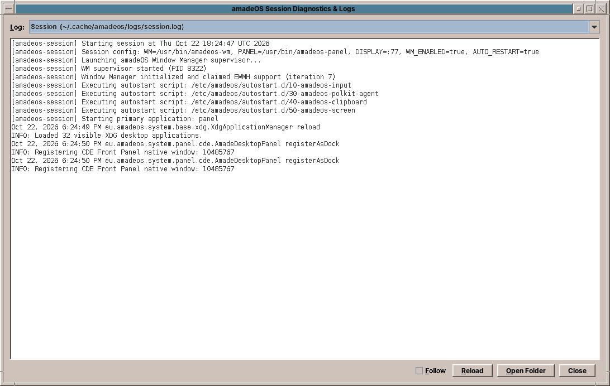
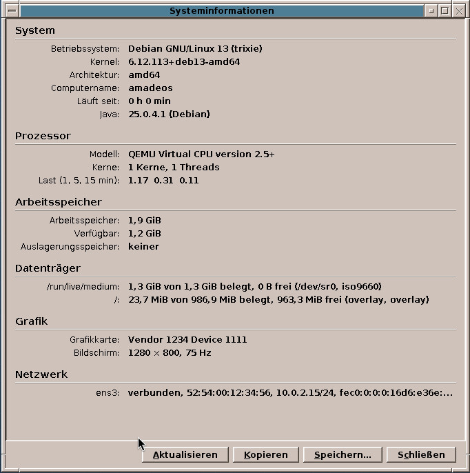

# 57. Troubleshooting

Something does not work. This chapter shows where amadeOS writes down what happened, how to describe your computer when you ask for help, and what to do when the desktop does not start at all.

## The logs

**Session Diagnostics & Logs** in the Tools drawer shows the logs of the desktop and its programs in one window.

The **Log** list at the top chooses what to read:

| Log | What it records |
|---|---|
| **Session** | The start of the session, its autostart scripts and the panel's messages. |
| **wm** | The window manager. |
| One entry per program | Every program started from the Front Panel writes its messages to a log of its own, for example *amade-mail*. |
| The greeter's session start and the X server | The start of the desktop after the login, and the display server. |
| The system journal | The messages of the whole system since this start. |

- **Follow** keeps the window at the end of the log, so that you see new lines as they are written. Turn it on, then repeat what went wrong.
- **Reload** reads the log again.
- **Open Folder** opens the folder of the desktop's logs, `~/.cache/amadeos/logs`, in the File Manager.

Lines with *SEVERE*, *ERROR*, *Exception* or *failed* are usually the ones that matter. The last lines before a program closed are often the explanation.

!!! tip
    The system journal can also be read in a terminal: `journalctl -b` shows everything since the start, `journalctl -b -p err` only the errors, `journalctl -b -u NetworkManager` the messages of one service. Members of the group `systemd-journal` may read it without a password.

## System information

**Hardware & System Info** in the Tools drawer shows on one page what your computer is: the system and its version, the processor, the memory, the disks and how full they are, the graphics, the network connections and the battery.

**Copy** puts all of it on the clipboard as text, **Save…** saves it to a file. That is what to add when you ask for help or report a bug: it answers the first questions anyone would ask.

## Common problems

| Problem | What to try |
|---|---|
| **A program does not start**, or closes at once | Open its log in Session Diagnostics & Logs. Start it in a terminal to see its messages directly, for example `amade-mail`. |
| **No network**, the network cell says *Network service is not running* | `sudo systemctl restart NetworkManager` in a terminal. |
| **No WLAN networks** in the list | The WLAN may be switched off by a key or switch on the laptop. `nmcli radio wifi on` switches it on; *System information* shows whether a WLAN device was found at all. |
| **No sound** | Point at the sound cell of the Front Panel: is the volume up, and is the right output chosen in its menu (chapter 27)? Check the volume in the program too. If the loudspeaker is grey and crossed out, `systemctl --user restart pipewire pipewire-pulse wireplumber` starts the sound system again. |
| **A printer prints nothing** | Look at its state in the Print Manager and choose *Resume* if it is paused (chapter 54). |
| **Software says *Another program is installing software*** | The daily update check, or automatic security updates, are running. Wait a few minutes. |
| **The window frames are gone** | The window manager has crashed; the session starts it again within a few seconds, and the windows get their frames back. If not, choose *Log Out…* in the Workspace Menu (right mouse button on the backdrop, chapter 24) and log in again. |
| **The Front Panel is gone and you are back at the greeter** | The panel ended, and the session with it. Log in again; the panel's log in Session Diagnostics & Logs (*Session*) says why. |
| **The screen stays locked and the password is not accepted** | Check the keyboard layout and ++caps-lock++. The screen lock takes the same password as the login. |

## When the desktop does not start

If the greeter appears but the desktop does not come up after the login, choose **Failsafe Terminal** in the *Session* list of the greeter (chapter 20) and log in. You get a single terminal window, without window manager and panel. From there:

1. Look at the session's log: `less ~/.cache/amadeos/logs/session.log` (++q++ ends it).
2. If you changed the session's settings, move them aside: `mv ~/.config/amadeos/session.conf ~/session.conf.old`.
3. If one of your settings is the cause, move the whole folder aside: `mv ~/.config/amadeos ~/amadeos-config.old`. The desktop then starts with its defaults.
4. Type `exit` to log out, and log in with *amadeOS CDE Desktop* again.

### Without the greeter

If not even the greeter appears, press ++ctrl+alt+f2++. A **text console** asks for your user name and password. Log in, and:

- `sudo systemctl restart amadeos-dm` starts the greeter again,
- `less /var/log/amadeos-xorg.log` shows why the X server did not start,
- `sudo reboot` restarts the computer.

++ctrl+alt+f7++ goes back to the graphical screen.

### A black screen after the boot menu

Some graphics cards do not get along with the driver Linux chooses at first. In the boot menu:

- **Live system:** choose *amadeOS Live (amd64 failsafe)*, which starts with the simplest settings.
- **Installed system:** when the boot menu appears, press ++e++ on the *amadeOS* entry. In the text that opens, find the line that starts with `linux`, go to its end and add a space and `nomodeset`. ++ctrl+x++ starts with that change, once. If the desktop then comes up, the graphics driver is the cause; install the fitting one in Software, or ask for help (below) with the text from *Hardware & System Info*.

!!! warning
    The *recovery mode* in *Advanced options for amadeOS* asks for the password of `root`, which amadeOS does not have (chapter 50). Use the text console or `nomodeset` instead.

## Asking for help

Every program and game of amadeOS has its own repository on GitHub, listed in chapter 40 for the applications and chapter 49 for the games. Report a problem with one program on the *Issues* page of its repository, a problem with the desktop itself (Front Panel, windows, Settings, login) at <https://github.com/amadeos-eu/amadeos-system/issues>, and everything else, such as installing, starting or updating, at <https://github.com/amadeos-eu/amadeos/issues>. A good report says:

1. what you did,
2. what you expected,
3. what happened instead,
4. and adds the text from *Hardware & System Info* and the relevant lines of the log.

!!! sovereignty "Your data"
    amadeOS sends no crash reports and no diagnostics anywhere by itself. Logs stay on your computer; you decide what you share. Look through a log before you post it: it may contain names of your files or networks.

??? hood "Under the hood"
    The log viewer `amadeos-logviewer` lists the `*.log` files of `~/.cache/amadeos/logs`, `/var/log/amadeos-session-runner.log`, `/var/log/amadeos-xorg.log` and the output of `journalctl -b`. The greeter is the systemd service `amadeos-dm.service`, an alias of `display-manager.service`; its Xorg runs on the seventh virtual terminal. *Hardware & System Info* (`amadeos-sysinfo`) reads `/etc/os-release`, `/proc` and `/sys`, and asks `lspci` for the graphics adapters.
