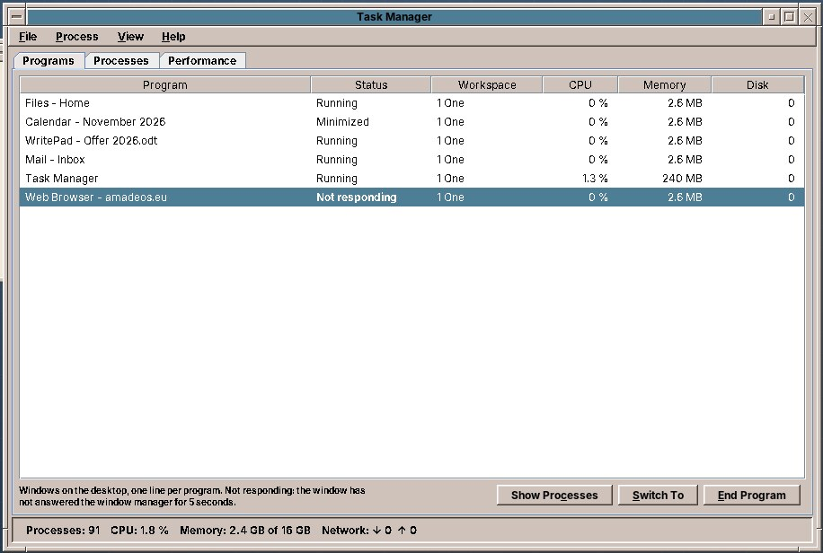
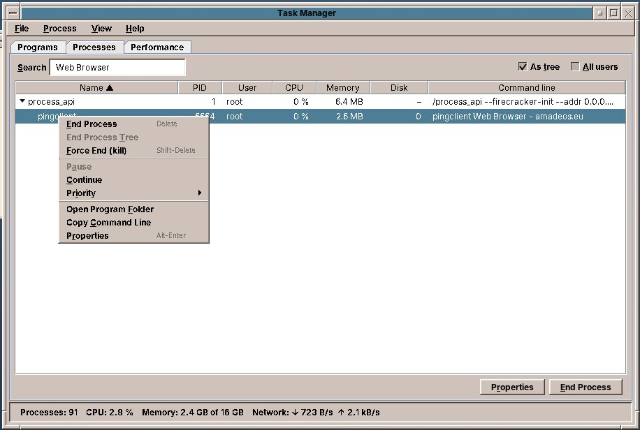
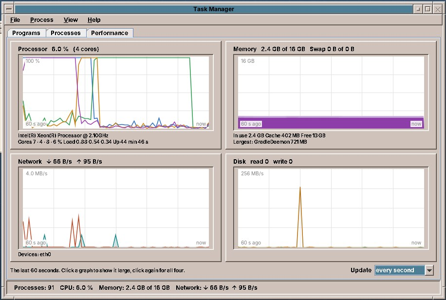
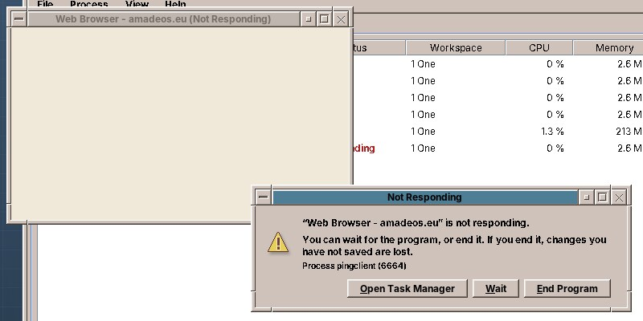

# 59. Task Manager

The **Task Manager** shows which programs and processes run on the computer, how busy the processor, the memory, the network and the disk are, and it ends a program that hangs.

Open it from the **Tools** drawer of the Front Panel, or press ++ctrl+shift+esc++ or ++ctrl+alt+del++ anywhere on the desktop. The keys open the window that is already there instead of a second one. In a terminal, `amadeos-taskmanager` starts it; `--processes` and `--performance` open it on that tab.

Its three tabs are also on ++ctrl+1++, ++ctrl+2++ and ++ctrl+3++. The bar at the bottom shows the number of processes, the processor load, the memory in use and the network traffic at a glance. ++f5++ updates everything at once; *View › Update Speed* chooses every second, every 2 or 5 seconds, or *Paused*.

## Programs

One line for each program window on the desktop, on all four workspaces:

| Column | What it shows |
|---|---|
| **Program** | The title of the window. |
| **Status** | *Running*, *Minimized*, or *Not responding* in red (below). |
| **Workspace** | The workspace the window is on. |
| **CPU**, **Memory**, **Disk** | What the program uses, together with the processes it started: the processor in percent of the whole computer, the memory, and how much it reads and writes per second. |

**Switch To** (or a double click) brings the window to the front, and changes to its workspace first. **End Program** ends it (below). **Show Processes** opens the Processes tab on the program's process.

## Processes

A **process** is a program that runs. A window is one process or several, and many processes have no window at all: the desktop itself, the sound system, the services of the system.

The tab lists your own processes as a **tree**: each process under the one that started it. ▸ and ▾ in front of a name, or ++left++ and ++right++, close and open a branch. Untick **As tree** for a plain list. **All users** also shows the processes of the system and of other users. A click on a column heading sorts by it, a second click the other way round; **Search** keeps the processes whose name, command line or user contains the text, or whose process ID (PID) it is, with the processes above them in the tree.

The right mouse button on a process, or the *Process* menu, offers:

| Entry | What it does |
|---|---|
| **End Process** (++del++) | Asks the process to quit, as closing its window would (below). |
| **End Process Tree** | The same for the process and all the processes it started. |
| **Force End (kill)** (++shift+del++) | Stops the process at once. It cannot save anything. |
| **Pause** / **Continue** | Stops the process without ending it, and lets it go on. A paused process uses no processor time; its windows do not redraw, so the window manager soon marks them *Not responding*. |
| **Priority** | *Very high* to *Very low*. A process with a lower priority gets the processor only when the others leave time over: good for a long conversion in the background. Raising the priority above *Normal* needs the administrator's password. |
| **Open Program Folder** | Opens the folder of the program file in the file manager. |
| **Copy Command Line** | Puts the command that started the process on the clipboard. |
| **Properties** (++alt+enter++) | The details: parent process, user, state, start time, processor time, memory, threads, program file, working folder, open files and control group. |

Processes of other users and of the system can only be ended or changed with the **administrator's password** (chapter 50). The Task Manager warns before you end a part of the desktop or the system, for example the window manager or the session: ending those can log you out or make the computer stop working.

## Performance

Four graphs of the last 60 seconds, new at the right:

- **Processor**: one line for each core, with the processor's name, the load average and how long the computer has been running.
- **Memory**: memory in use, as cache and free, and the swap space; the largest process is named below.
- **Network**: received (↓) and sent (↑) per second, over all network devices.
- **Disk**: read and written per second, over all disks.

A click on a graph shows it large; a second click shows all four again. The graphs scale themselves to what happens, so a small download fills the network graph as well as a big one.

## Ending a program

**End Program** and **End Process** first ask the program politely to quit. A program that is fine closes as it would on *Quit*; one with unsaved work may ask whether to save it. If it is still running after **5 seconds**, the dialog says *Still running after 5 seconds* and offers **Force End**, which stops it at once. Its unsaved changes are then lost.

## When a program does not respond

Every two seconds the window manager asks the active window whether its program is still there, and again when you click a window's close button. A program that has not answered for **5 seconds** gets *(Not Responding)* after its title, and a dialog asks what to do:

- **Wait** closes the dialog. A program that is busy with a long task often answers again; then the dialog closes by itself, and the title loses the mark.
- **End Program** ends it, as above.
- **Open Task Manager** shows the program in the Task Manager.

!!! note
    Not every program can be checked. Programs that do not take part in the window manager's question, and amadeOS programs whose window still redraws while they are busy, are never marked. They can still be ended in the Task Manager.

## What the Task Manager cannot do yet

!!! planned "Planned"
    A small processor and memory graph in the Front Panel that opens the Task Manager, as one of the extra cells of a customizable Front Panel (appendix E). The load of the graphics card, and the network use of each program, are not shown: both need more than the files of `/proc`.

!!! info "For the curious"
    The Task Manager (`amadeos-taskmanager`, a module of amadeos-system) reads everything from the files of `/proc`: `/proc/stat`, `/proc/meminfo`, `/proc/net/dev`, `/proc/diskstats` and, for each process, `/proc/<pid>/stat`, `status`, `cmdline` and `io`; it starts no `ps` or `top`. It finds the process of a window through `_NET_WM_PID`. It ends, pauses and continues processes with `kill -s TERM`, `KILL`, `STOP` and `CONT`, changes the priority with `renice`, and uses `pkexec` for processes of other users. The window manager's question is the freedesktop.org `_NET_WM_PING` message; it marks a window that does not answer with the property `_AMADEOS_NOT_RESPONDING` and starts `amadeos-taskmanager --not-responding <window>`.
