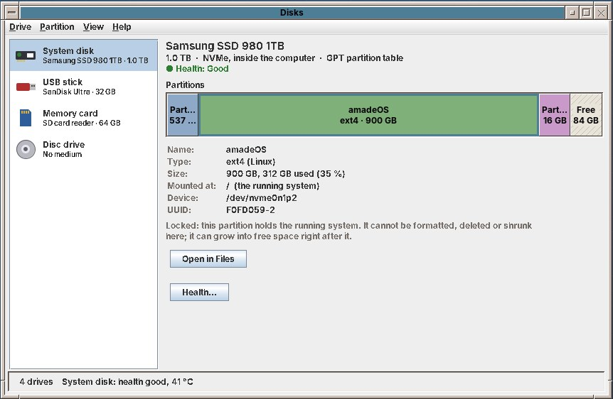
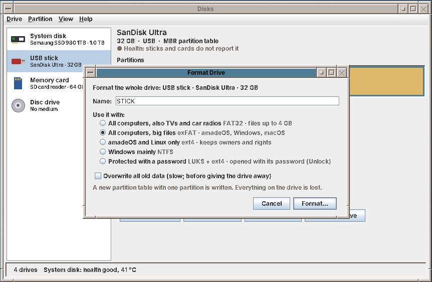
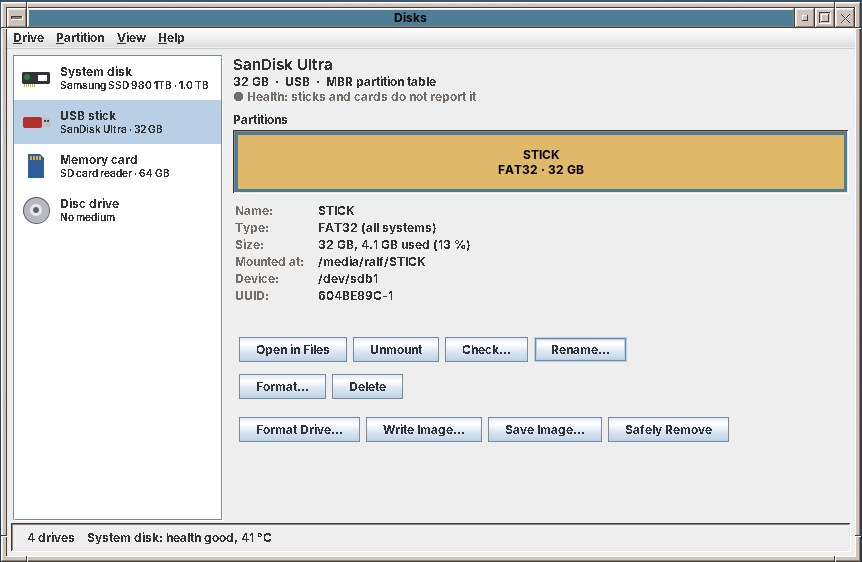
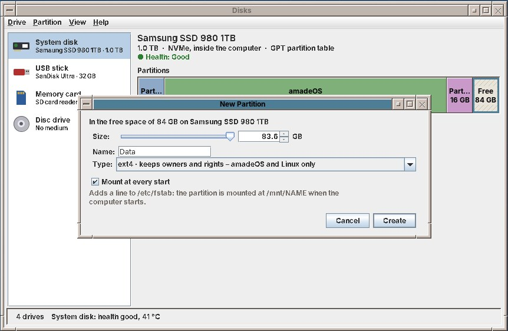
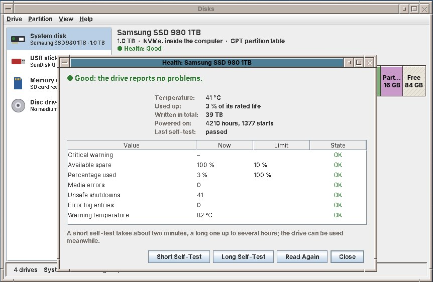
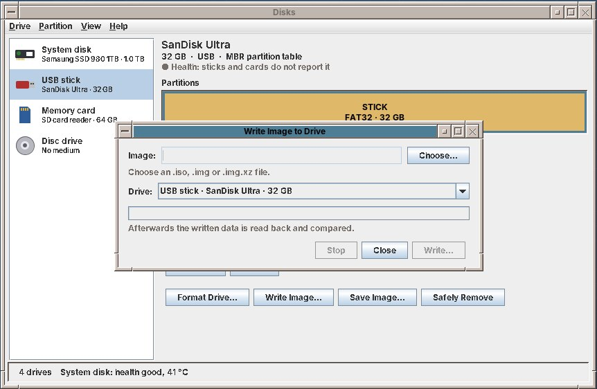

# 59. Task Manager and Disks

This chapter is about two tools of the **Tools** drawer: the Task Manager, and **Disks** for drives, partitions and their health (below).

The **Task Manager** shows which programs and processes run on the computer, how busy the processor, the memory, the network and the disk are, and it ends a program that hangs.

Open it from the **Tools** drawer of the Front Panel, or press ++ctrl+shift+esc++ or ++ctrl+alt+del++ anywhere on the desktop. The keys open the window that is already there instead of a second one. In a terminal, `amadeos-taskmanager` starts it; `--processes` and `--performance` open it on that tab.

Its three tabs are also on ++ctrl+1++, ++ctrl+2++ and ++ctrl+3++. The bar at the bottom shows the number of processes, the processor load, the memory in use and the network traffic at a glance. ++f5++ updates everything at once; *View › Update Speed* chooses every second, every 2 or 5 seconds, or *Paused*.

## Programs

One line for each program window on the desktop, on all four workspaces:

| Column | What it shows |
|---|---|
| **Program** | The title of the window. |
| **Status** | *Running*, *Minimized*, or *Not responding* in red (below). |
| **Workspace** | The workspace the window is on. |
| **CPU**, **Memory**, **Disk** | What the program uses, together with the processes it started: the processor in percent of the whole computer, the memory, and how much it reads and writes per second. |

**Switch To** (or a double click) brings the window to the front, and changes to its workspace first. **End Program** ends it (below). **Show Processes** opens the Processes tab on the program's process.

## Processes

A **process** is a program that runs. A window is one process or several, and many processes have no window at all: the desktop itself, the sound system, the services of the system.

The tab lists your own processes as a **tree**: each process under the one that started it. ▸ and ▾ in front of a name, or ++left++ and ++right++, close and open a branch. Untick **As tree** for a plain list. **All users** also shows the processes of the system and of other users. A click on a column heading sorts by it, a second click the other way round; **Search** keeps the processes whose name, command line or user contains the text, or whose process ID (PID) it is, with the processes above them in the tree.

The right mouse button on a process, or the *Process* menu, offers:

| Entry | What it does |
|---|---|
| **End Process** (++del++) | Asks the process to quit, as closing its window would (below). |
| **End Process Tree** | The same for the process and all the processes it started. |
| **Force End (kill)** (++shift+del++) | Stops the process at once. It cannot save anything. |
| **Pause** / **Continue** | Stops the process without ending it, and lets it go on. A paused process uses no processor time; its windows do not redraw, so the window manager soon marks them *Not responding*. |
| **Priority** | *Very high* to *Very low*. A process with a lower priority gets the processor only when the others leave time over: good for a long conversion in the background. Raising the priority above *Normal* needs the administrator's password. |
| **Open Program Folder** | Opens the folder of the program file in the file manager. |
| **Copy Command Line** | Puts the command that started the process on the clipboard. |
| **Properties** (++alt+enter++) | The details: parent process, user, state, start time, processor time, memory, threads, program file, working folder, open files and control group. |

Processes of other users and of the system can only be ended or changed with the **administrator's password** (chapter 50). The Task Manager warns before you end a part of the desktop or the system, for example the window manager or the session: ending those can log you out or make the computer stop working.

## Performance

Four graphs of the last 60 seconds, new at the right:

- **Processor**: one line for each core, with the processor's name, the load average and how long the computer has been running.
- **Memory**: memory in use, as cache and free, and the swap space; the largest process is named below.
- **Network**: received (↓) and sent (↑) per second, over all network devices.
- **Disk**: read and written per second, over all disks.

A click on a graph shows it large; a second click shows all four again. The graphs scale themselves to what happens, so a small download fills the network graph as well as a big one.

## Ending a program

**End Program** and **End Process** first ask the program politely to quit. A program that is fine closes as it would on *Quit*; one with unsaved work may ask whether to save it. If it is still running after **5 seconds**, the dialog says *Still running after 5 seconds* and offers **Force End**, which stops it at once. Its unsaved changes are then lost.

## When a program does not respond

Every two seconds the window manager asks the active window whether its program is still there, and again when you click a window's close button. A program that has not answered for **5 seconds** gets *(Not Responding)* after its title, and a dialog asks what to do:

- **Wait** closes the dialog. A program that is busy with a long task often answers again; then the dialog closes by itself, and the title loses the mark.
- **End Program** ends it, as above.
- **Open Task Manager** shows the program in the Task Manager.

!!! note
    Not every program can be checked. Programs that do not take part in the window manager's question, and amadeOS programs whose window still redraws while they are busy, are never marked. They can still be ended in the Task Manager.

## What the Task Manager cannot do yet

!!! planned "Planned"
    A small processor and memory graph in the Front Panel that opens the Task Manager, as one of the extra cells of a customizable Front Panel (appendix E). The load of the graphics card, and the network use of each program, are not shown: both need more than the files of `/proc`.

!!! info "For the curious"
    The Task Manager (`amadeos-taskmanager`, a module of amadeos-system) reads everything from the files of `/proc`: `/proc/stat`, `/proc/meminfo`, `/proc/net/dev`, `/proc/diskstats` and, for each process, `/proc/<pid>/stat`, `status`, `cmdline` and `io`; it starts no `ps` or `top`. It finds the process of a window through `_NET_WM_PID`. It ends, pauses and continues processes with `kill -s TERM`, `KILL`, `STOP` and `CONT`, changes the priority with `renice`, and uses `pkexec` for processes of other users. The window manager's question is the freedesktop.org `_NET_WM_PING` message; it marks a window that does not answer with the property `_AMADEOS_NOT_RESPONDING` and starts `amadeos-taskmanager --not-responding <window>`.

## Disks

**Disks** shows the drives of the computer: the disk the system runs from, other disks, USB sticks, memory cards and disc drives. It formats a stick or a card, makes and changes partitions, checks file systems, tells how healthy a disk is, and writes a disk image (such as a new amadeOS stick) onto a drive.

Open it from the **Tools** drawer of the Front Panel. In the File Manager, the right mouse button on a USB stick or a card offers **Format…**, which opens Disks with the format dialog for that drive. In a terminal, `amadeos-disks` starts it; `--drive /dev/sdb` opens it on that drive and `--format /dev/sdb` with the format dialog.

The list on the left names each drive in plain words (*System disk*, *USB stick*, *Memory card*, *Disc drive*) with its model and size. A stick you plug in appears after a moment, and disappears when you pull it out. On the right:

- the model, the size, how it is connected (*NVMe, inside the computer*, *USB*) and its partition table (*GPT* or *MBR*), then a line with its **health**;
- the **partition map**: one coloured block for each partition, in the order they lie on the drive, and hatched blocks for free space. Click a block to select it;
- the details of the selected partition: name, type, size and how much is used, where it is mounted, the device name and the UUID;
- the buttons of the steps that fit this partition and this drive. The same steps are in the *Drive* and *Partition* menus.

Every step that changes a drive asks for the **administrator's password** (chapter 50) the first time. One step runs at a time; the status line at the bottom says what is happening.

### The system disk is protected

The partitions the running system uses are **locked**: the system itself (`/`), `/boot` and `/boot/efi`, `/home` and the other system folders when they are partitions of their own, and the swap space. Parts of LVM volume groups and RAID arrays are locked too; Disks leaves them alone. Disks says so below the details (*Locked: this partition holds the running system*). A locked partition cannot be formatted, deleted or shrunk, and the system disk as a whole cannot be formatted or overwritten with an image. You can still look at it, check its health, create a partition in free space on it, and let a partition grow into free space right after it.

### Formatting a USB stick or a memory card

Select the stick and click **Format Drive…**. The dialog asks for a **name** (it appears in the File Manager) and what you want to use the stick with:

| Choice | File system | Good for |
|---|---|---|
| **All computers, also TVs and car radios** | FAT32 | Any device; but no file larger than 4 GB. The default for sticks and cards up to 32 GB. |
| **All computers, big files** | exFAT | amadeOS, Windows and macOS, cameras; files of any size. The default above 32 GB. |
| **amadeOS and Linux only** | ext4 | Keeps owners and permissions; for backups and Linux computers. |
| **Windows mainly** | NTFS | A disk that is mostly used with Windows. |
| **Protected with a password** | LUKS + ext4 | Encrypted: without the password nobody can read it. To open it, select it in Disks and click **Unlock…**. |

**Overwrite all old data** writes zeros over the whole drive first; this takes long, but nobody can get the old files back afterwards. Use it before you give a stick away.

**Format…** then shows one last question, which names the drive by its model and size and lists the partitions and files that will be lost. *Cancel* is the default button; the red button says what happens: **Erase and Format**. Disks unmounts the stick, writes a new partition table with one partition and formats it.

!!! warning
    Formatting cannot be undone. Look twice at the drive name in the question: the system disk is protected, but another disk or stick is not.

### Working with partitions

Select a partition in the map, then:

| Button | What it does |
|---|---|
| **Open in Files** | Opens the partition in the File Manager, mounting it first. |
| **Mount** / **Unmount** | Makes the partition's files reachable (below `/media/YOUR-NAME`), and takes them away again. |
| **Unlock…** / **Lock** | For an encrypted partition: asks for its password and opens it, and closes it again. |
| **Check…** | Looks for errors in the file system. It is unmounted while it is checked. When it finds errors, Disks offers **Repair**. Make a backup first if you can. |
| **Rename…** | Changes the name. FAT allows 11 characters (in capitals), exFAT 15, ext4 16 and NTFS 32. |
| **Format…** | Formats only this partition, with the same choices as above. The other partitions stay. |
| **Delete** | Deletes the partition; its space becomes free space. |
| **Resize…** | Grows or shrinks the partition: ext4, FAT and NTFS. It can grow only into free space right after it. Shrinking unmounts it for the time. |

Select a **free** block to make a new partition there with **New Partition…**:

Choose the size, a name and the type, with the same choices as for a stick. **Mount at every start** adds a line to `/etc/fstab`, so the partition is mounted at `/mnt/NAME` each time the computer starts. Mounting it the first time happens at the next start.

!!! tip
    If a step says *The drive is in use*, a program still has a file open on it, often a File Manager window that shows a folder on it. Close it, and try again.

### Health

Disks, SSDs and NVMe drives keep values about their own state (*S.M.A.R.T.*). The line under the drive's name gives the short verdict; **Health…** shows the details:

- a plain verdict on top: **Good**, **Watch it** (it works, but shows first signs of wear) or **Replace soon** (copy your data to another drive now), with the reason;
- temperature, how much of its rated life it has used up, how much has been written to it in total, the hours it was switched on, and the result of the last self-test;
- below, the raw values with their limits.

**Short Self-Test** takes about two minutes, **Long Self-Test** up to several hours; you can use the computer meanwhile. USB sticks and most memory cards report no health; Disks says so instead of showing nothing.

### Writing an image to a stick

**Write Image…** copies a disk image (`.iso`, `.img`, or `.img.xz`, which is unpacked on the way) onto a stick or a card, for example to make a new amadeOS stick for another computer:

1. Select the stick and click **Write Image…**, then **Choose…** the image file.
2. When a checksum file lies next to the image (`NAME.sha256`, `NAME.sha256sum` or `SHA256SUMS`, as on amadeos.eu), Disks checks it first and says *checksum SHA-256 matches*. If it does not match, the file is damaged or not the original: download it again.
3. **Write…** asks once more (*Erase and Write*), then writes, and at the end reads everything back and compares it. *Done: written and compared, all correct.*

**Save Image…** does the opposite: it saves a whole stick or card as an `.img` file, or packed as `.img.xz`, for example before you try something on it.

!!! note
    An image always fills the whole stick, whatever was on it before. After you used a stick for an image, use **Format Drive…** to make it a normal stick again.

### What Disks cannot do yet

!!! planned "Planned"
    The File Manager asking for the password when an encrypted stick is plugged in (today: **Unlock…** in Disks). A daily health check that shows a notification when a disk's verdict gets worse; a speed test; erasing an SSD with its own secure-erase command; showing RAID and LVM volumes and Btrfs subvolumes. Moving partitions is not planned: it is slow and risky.

!!! info "For the curious"
    Disks (`amadeos-disks`, a module of amadeos-system) does nothing as root itself. It talks to the **udisks** service over D-Bus, which runs `mkfs`, `sfdisk`/`parted`, `fsck`, `resize2fs` and `cryptsetup` and asks polkit for the administrator's password, so the amadeOS password dialog appears. For images, udisks opens the device after the password and hands Disks a file descriptor; Disks copies in 4 MB blocks and computes the SHA-256 on the way. The lock on the running system comes from udisks and, as a second opinion, from `/proc/self/mountinfo` and `/proc/swaps`.
