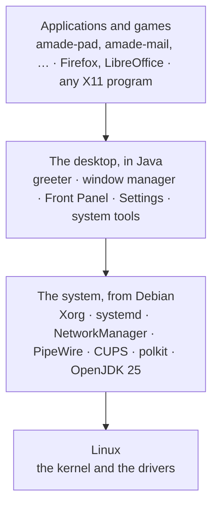

# 60. How amadeOS Is Built

The last part of the book is for the curious. You do not need it to use amadeOS. It shows what amadeOS is made of, how the pieces talk to each other, how you build the system yourself and how you write a program for it.

## Four layers

amadeOS is a stack of four layers. Each one uses only the layer below it, through documented interfaces.

| Layer | Where it comes from | Who looks after it |
|---|---|---|
| **Linux** | The Linux kernel as Debian builds it | The kernel developers and Debian |
| **The system** | Debian 13 *trixie*, a minimal installation | The Debian project, with its security team |
| **The desktop** | The packages of amadeOS, written in Java | The amadeOS project |
| **Applications** | The amade applications and games, and any Debian program | Their authors |

amadeOS writes only the third layer and its own applications. Everything below is the same Debian that runs on millions of servers and desktops. That keeps amadeOS small enough to understand, and it means that security updates for the base come from Debian, on Debian's schedule (chapter 52).

## Everything is a package

Every part of amadeOS is an ordinary **Debian package**, a `.deb` file. The desktop is a handful of packages, each application is one, each game is one:

| Package | What it is | Chapter |
|---|---|---|
| `amadeos-dm` | The login greeter (display manager) | 20 |
| `amadeos-session` | The session, screen lock and screen saver, the password window, the clipboard manager | 26, 34, 36, 55 |
| `amadeos-wm` | The window manager | 23, 24, 61 |
| `amadeos-panel-cde` | The Front Panel | 22 |
| `amadeos-settings` | Settings | Part IV |
| `amadeos-software`, `amadeos-packages` | Software and its helper | 51, 52 |
| `amadeos-print`, `amadeos-logviewer`, `amadeos-sysinfo` | Print Manager, logs, system information | 54, 57 |
| `amadeos-installer` | *Install amadeOS* | 14 |
| `amadeos-handbook` | This book | 48 |
| `amade-pad`, `amade-mail`, … | The applications | Part V |
| `amade-mines-game`, … | The games | 49 |

Each Java package puts its program into `/opt/<package>/` and a small start script into `/usr/bin/`. They depend on Debian's Java runtime, `openjdk-25-jre`, like any other program depends on its libraries. `dpkg -L amadeos-wm` lists what one package installs.

!!! tip
    Because the desktop is packages, it can be installed on a plain Debian system too, and parts of it can be replaced: chapter 55 shows how another panel takes the Front Panel's place.

## The repositories

The source code lives in public Git repositories at <https://github.com/datazuul>:

| Repository | What is in it |
|---|---|
| `amadeos` | The live image: its package list, its settings, the boot menus, the build scripts, this book |
| `amadeos-system` | The desktop and the system tools, one module per package |
| `amadeos-installer` | The installer |
| `amade-commons` | The library all amade applications share: look, colours, languages, settings |
| `amade-game-engine` | The engine of the games |
| `amade-<name>` | One repository per application, for example `amade-pad` |
| `amade-<name>-game` | One repository per game, for example `amade-mines-game` |

## From packages to a USB stick

The **live image**, the file you write to a USB stick (chapter 12), is built by *live-build*, Debian's tool for live systems. It takes:

1. a list of Debian packages (`config/package-lists/amadeos.list.chroot` in the `amadeos` repository),
2. the amadeOS packages, built from their repositories,
3. a few settings files: the live user, the keyboard, Firefox's privacy settings, the backdrops,

and makes of them a compressed file system (*squashfs*) with a boot loader for BIOS and UEFI computers, packed into one ISO file.

**Installing** (chapter 14) does not build anything anew. The installer copies that same file system onto the disk, removes what only the live system needs and adds the user, the boot loader and the disk settings. So the installed system is exactly the one you tried on the stick, and the installation needs no network.

!!! sovereignty "Your data"
    Every step from the source code to the ISO is public and can be repeated by anyone with a Debian computer (chapter 62). You do not have to trust a download: you can build the same system yourself.

!!! planned "Planned"
    An amadeOS package repository (ROADMAP milestone M16), so that the amadeOS packages are updated like Debian's instead of only with a new image, and signed images with a release manifest (M12).

??? hood "Under the hood"
    The licence of amadeOS is the EUPL-1.2 (chapter 4). The image is an aggregation of packages, and each keeps its own licence: `/usr/share/doc/<package>/copyright` names it. The NsCDE icon theme (GPL-3.0) and the CDE backdrops (LGPL) are packages of their own for that reason. The design decisions behind amadeOS, and the alternatives that were rejected, are in `CONCEPT.md` of the `amadeos` repository; the plan is in `ROADMAP.md`.
