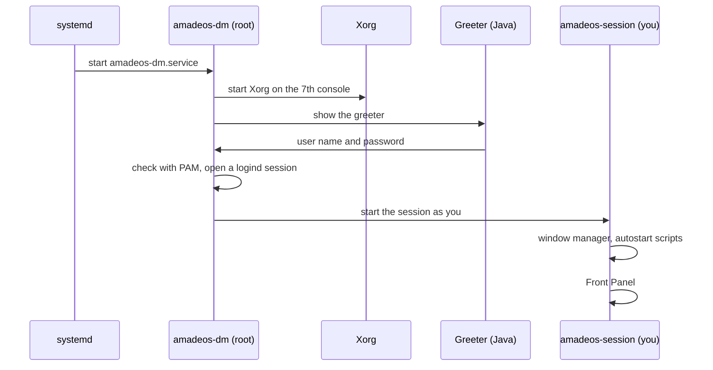

# 61. The Desktop and X11

This chapter follows what happens between switching the computer on and the Front Panel appearing, and explains how Java programs draw windows that ordinary Linux programs share.

## X11 in a few words

The screen, the keyboard and the mouse belong to one program, the **X server** (on amadeOS, *Xorg*). Every program with a window is an **X client**: it connects to the X server, asks for windows and draws into them, and gets the key presses and mouse clicks meant for it. X11 is the protocol they speak, version 11, unchanged in its core since 1987.

One X client has a special job: the **window manager**. It decides where windows appear, draws their frames, moves and resizes them when you drag a frame, and switches workspaces. The X server lets only one window manager run at a time.

## From power on to the Front Panel

1. **systemd**, the first program of the system, starts the service `amadeos-dm`.
2. `amadeos-dm` starts **Xorg** on the seventh virtual console, with a secret cookie so that only it may connect at first.
3. The **greeter** appears: a Java program on the X server, with the language, keyboard and time zone lists.
4. When you log in, a part of `amadeos-dm` that runs as root checks the password through **PAM**, the password service of Linux. PAM also unlocks your keyring (chapter 58). systemd-logind then opens a session for you, so that sound and USB devices belong to you.
5. The session is started **as you**: `amadeos-session` starts the window manager, the autostart scripts and the Front Panel (chapter 55).

The greeter's part that runs as root does only what needs root: checking the password, setting the time zone, starting the session. Everything you see runs with your own rights.

## The window manager

The window manager, `amadeos-wm`, is a Java program that talks to Xorg through `libX11`, the C library of X11, using *JNA* (Java Native Access). It is a **reparenting** window manager: it puts every window into a frame window of its own and draws the Motif frame there, the title, the buttons and the resize borders. That is why every program gets the same frames, whether it is written in Java, C or anything else.

Programs and the window manager agree through two written conventions:

| Convention | What it settles |
|---|---|
| **ICCCM** (1988) | The basics: a window's title, its minimum size, how a program is asked to close a window (`WM_DELETE_WINDOW`), who gets the keyboard. |
| **EWMH** (freedesktop.org) | The modern desktop: the list of windows, the active window, workspaces, maximized and full-screen windows, and *docks*. |

The Front Panel is a window of the kind *dock*: the window manager keeps it in front, gives it no frame and keeps other windows from covering it. It knows no panel by name; any program that says it is a dock is treated the same way, which is how another panel can take its place.

!!! tip
    `xprop` and a click on a window shows what that window tells the window manager, for example `_NET_WM_NAME` (its title) and `_NET_WM_WINDOW_TYPE` (its kind). `xwininfo -tree -root` shows the windows inside their frames.

## Swing and the amadeOS look

The amade applications are **Swing** programs, the toolkit that comes with Java. Swing draws every button and menu itself, which makes it easy to give all of them the same CDE look. The library *amade-commons* does that for every application: the Motif look and feel, the colours of the chosen palette, the language, the settings files.

When you choose a palette in Settings, it writes `~/.config/amadeos/theme.conf`. The window manager, the panel and every running amade application watch that file and change their colours at once. No message bus and no daemon are involved: a small text file is the whole interface, and you can read it.

## Why X11 and not Wayland

*Wayland* is the newer display system that some Linux desktops use. In Wayland, the window manager and the display server are one program, the *compositor*, which then also has to handle input, drawing and screen management. amadeOS starts with X11 because its window-manager protocol is well understood, Java's desktop toolkit works with it, and the tools to look inside it exist. Wayland is not ruled out: it can be considered once the desktop is complete on X11 (chapter 6).

??? hood "Under the hood"
    The greeter writes its log to `/var/log/amadeos-session-runner.log`, Xorg to `/var/log/amadeos-xorg.log`, the window manager to `~/.cache/amadeos/logs/wm.log` (chapter 57). The PAM services are `/etc/pam.d/amadeos-dm` and `/etc/pam.d/amadeos-lock`. The window manager uses only Xlib calls that it needs and keeps them behind one Java interface, so that a later change to Java's own native interface (FFM) or to XCB stays in one place. The design and its alternatives are in `CONCEPT.md` of the `amadeos` repository.
