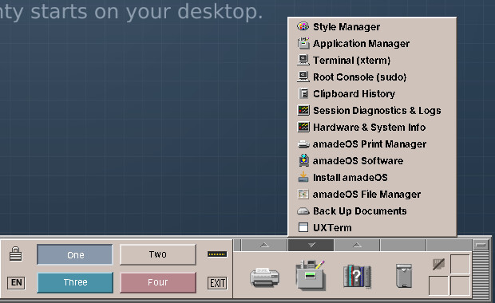

# 63. Writing an Application for amadeOS

amadeOS runs every Linux program that has a window for X11. This chapter shows the smallest way to put a program of your own into the Front Panel, what makes a program an *amade application*, and where the handbooks for programmers continue.

## Any program, in the Front Panel

The drawers of the Front Panel fill themselves from **desktop entries**, small text files that describe a program: its name, its icon, the command that starts it and the kinds it belongs to. They are a freedesktop.org standard, so the same file works on other Linux desktops too.

Your own desktop entries go into `~/.local/share/applications/`. Say you have a script `~/bin/backup.sh` that copies your documents to a USB disk. Save this as `~/.local/share/applications/backup.desktop`:

```ini
[Desktop Entry]
Type=Application
Name=Back Up Documents
Name[de]=Dokumente sichern
Comment=Copies the documents folder to the backup disk
Exec=/home/alex/bin/backup.sh
Icon=drive-harddisk
Terminal=true
Categories=System;
```

`Terminal=true` runs the script in a terminal window, so you see what it prints. The Front Panel notices the new file at once: *Back Up Documents* appears in the Tools drawer, the drawer of the kind `System`, and in the Application Manager. 



`Name[de]` gives the German name; the panel shows the one of your language.

The `Categories` decide the drawer:

| Categories | Drawer |
|---|---|
| `FileManager` | File Manager |
| `TextEditor`, `WordProcessor`, `Office`, `Calendar`, `Spreadsheet` | Text & Office |
| `Email`, `Network`, `WebBrowser`, `Chat` | Mail & Internet |
| `AudioVideo`, `Audio`, `Video`, `Player` | Sound & Video |
| `Graphics`, `Viewer`, `Photography`, `Scanning` | Graphics |
| `Game` | Games |
| `Printing` | Print Manager |
| `Settings`, `System` | Tools |
| `Documentation` | Help |

Programs of other kinds, such as `Utility`, `Development` or `Education`, are listed in the Application Manager (chapter 22). A desktop entry for all users goes into `/usr/share/applications/`, which is what packages do.

!!! tip
    `desktop-file-validate backup.desktop` checks the file for mistakes.

## An amade application

The programs of Part V are **amade applications**: Java 25 programs with Swing, built on the shared library **amade-commons**. The library gives every application, with a few lines of code:

- the Motif look of CDE, in the colours of the palette and text size chosen in Settings, changing with them while the program runs;
- the five languages of the desktop, from simple text files, and the language chosen at login;
- its settings in `~/.config/amadeos/<application>`, its data in `~/.local/share/amadeos/<application>`;
- the standard menus, *About* window, toolbar buttons and printing;
- a Debian package with its desktop entry, icon and the AppStream description that Software shows (chapter 51).

Every amade application lives in a repository of its own and is a Debian package of its own. `amade-pad`, the Text Editor, is the smallest and the example the others follow.

## The handbooks for programmers

Two more books continue where this one ends. Both are installed on amadeOS, in the Help drawer, and on the web:

| Book | What it teaches | On the web |
|---|---|---|
| **Application Developer's Handbook** | Writing amade applications, from the Text Editor to the Audio Station, one chapter per application; the amade-commons manual; packaging; writing a module of the desktop itself. | <https://datazuul.github.io/amade-commons/> |
| **Game Developer's Handbook** | Writing games with the amade game engine, from Paddle to Town, one chapter per game; the engine manual. | <https://datazuul.github.io/amade-game-engine/> |

They assume that you can program a little, ideally in Java. They do not assume that you know Swing, X11 or Debian packages.

## Bringing your program to amadeOS

A program that should be part of amadeOS is welcome. The way in is:

1. a repository of its own, under a free licence that goes with the EUPL (chapter 4),
2. a Debian package built by its Gradle build, with `installToAmadeOs` to put it into the image,
3. an entry in `repositories.list` of the `amadeos` repository, so that `buildDistribution.sh` builds it (chapter 62).

Ideas and questions go to <https://github.com/amadeos-eu/amadeos/issues>; `CONTRIBUTING.md` in the `amadeos` repository describes the details.

!!! sovereignty "Your data"
    An application for amadeOS should do what the desktop does: keep the user's data on the computer, in open formats, and send nothing anywhere unless the user asks for it. The handbooks show how.

??? hood "Under the hood"
    The panel reads desktop entries from `~/.local/share/applications`, `/usr/local/share/applications` and `/usr/share/applications` (or the folders of `XDG_DATA_HOME` and `XDG_DATA_DIRS`) and watches them for changes. A folder that does not exist yet when you log in is watched as soon as it is created. An entry with `NoDisplay=true` or `Hidden=true` is left out. Icons are looked up by name in the icon theme chosen in Settings, then in `hicolor`.
